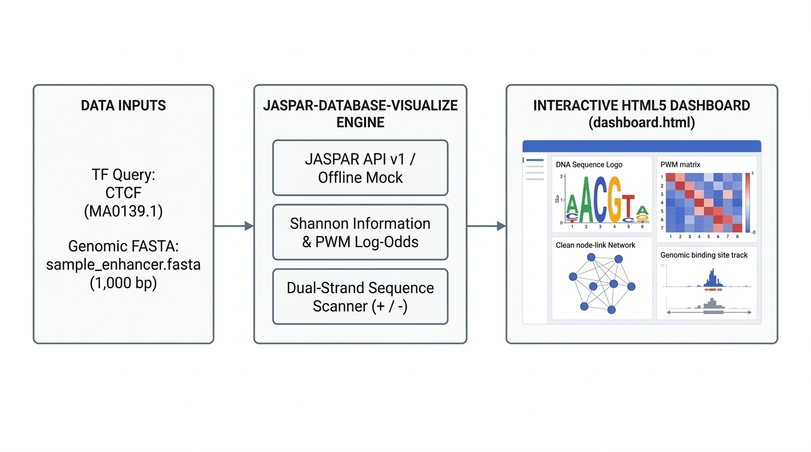

# JASPAR Database Visualize Skill (`jaspar-database-visualize`)

`jaspar-database-visualize` is a computational biology toolkit for transcription factor (TF) binding profile visualization, information-theoretic sequence logo rendering, Position Frequency/Probability/Weight Matrix (PFM/PPM/PWM) analysis, and dual-strand DNA sequence scanning built on the JASPAR REST API v1 (`https://jaspar.elixir.no/api/v1/`).



---

## 1. Capabilities Overview

This toolkit comprises five integrated analytical modules:
1. **JASPAR REST API v1 Client & Offline Fallback (`scripts/jaspar_api.py`)**: Resolves human and model-organism TF symbols (`CTCF`, `TP53`, `MYC`, `FOXA1`, `SOX2`, `JUN`, `GATA1`) to versioned JASPAR Matrix IDs, retrieves raw PFM counts, computes pseudocount-adjusted PPM and $\log_2$-odds PWM matrices, and exports motifs in `JASPAR`, `MEME`, `TRANSFAC`, `PFM`, `JSON`, and `YAML` formats.
2. **Vector Sequence Logo Engine (`scripts/visualize_logo.py`)**: Computes per-position Shannon entropy ($H_i$), small-sample correction ($e_n$), and information content ($R_i = 2 - (H_i + e_n)$ bits) to generate scalable SVG and interactive HTML5 sequence logos across forward ($5' \to 3'$) and reverse-complement ($3' \leftarrow 5'$) orientations.
3. **Matrix Heatmap & Information Explorer (`scripts/visualize_matrix.py`)**: Generates interactive heatmaps for PFM counts, PPM probabilities, and PWM $\log_2$-odds weights with configurable Laplace/Dirichlet pseudocounts and background GC fractions.
4. **Dual-Strand DNA Sequence Scanner (`scripts/visualize_scan.py`)**: Scans user-provided FASTA files or inline DNA sequences across both forward (`+`) and reverse (`-`) strands, normalizes raw scores to relative affinity ($0.00 \text{ to } 1.00$), and maps binding site coordinates.
5. **Standalone Interactive HTML5 Dashboard (`scripts/generate_dashboard.py` & `scripts/run_pipeline.py`)**: Compiles processed motif data and sequence scan results into a self-contained `dashboard.html` file featuring a Light/Dark theme toggle, live client-side sequence scanning, a 3D Motif Relationship Network, and a 3D DNA Binding Groove viewer.

---

## 2. User Guide for Non-Technical Users

You do not need programming experience to use this skill. By providing a protein name (transcription factor) and an optional DNA sequence, you can identify where regulatory proteins attach to DNA and inspect the results visually in your web browser.

### How to Use This Skill
1. **Provide Your Protein Name or DNA Sequence**: Specify the transcription factor you want to study (for example, `MYC`, `TP53`, `CTCF`, `FOXA1`, or `SOX2`), and optionally supply a DNA sequence composed of `A`, `C`, `G`, and `T` letters or a `.fasta` sequence file.
2. **Automated Binding Analysis**: The toolkit retrieves the experimentally validated binding profile from the JASPAR database, scores every position along both strands of your DNA sequence, and generates a visual report.
3. **Explore the Interactive Report (`dashboard.html`)**: Open `dashboard.html` in any web browser. Within the dashboard, you can:
   - Toggle between Light and Dark display themes using the **Theme: Light / Dark** button in the top-right corner.
   - Read the **Sequence Logo**, where taller letters represent DNA positions that are strongly required for the protein to bind.
   - Inspect the **Genomic Binding Sites** map and table, which pinpoint the exact start and end coordinates where the protein attaches on the forward (`+`) or reverse (`-`) DNA strand.
   - Paste or edit DNA sequences directly inside the **Input Data & Live Sequence Scanner** box, adjust the **Relative Cutoff** slider, and click **Run Sequence Scan** to test new sequences immediately.
   - Drag to rotate and scroll to zoom the **Motif Relationship Network** and **3D DNA Binding Groove** models.

### Real-World Examples

- **Example 1: Analyzing a Gene Promoter from a Laboratory Experiment**
  - *Scenario*: A researcher has isolated a 52-base-pair DNA segment upstream of a human gene (`GCTAGCTAGCGACCACGTGGTCGATCGATCGGACCACGTGGTCGATCGATCG`) and wants to determine whether the cell-growth regulator protein `MYC` binds to this region.
  - *How to run or request*: Specify the protein name `MYC` and the DNA sequence `GCTAGCTAGCGACCACGTGGTCGATCGATCGGACCACGTGGTCGATCGATCG`.
  - *Result*: The skill resolves human `MYC` (`MA0147.3`), scans both DNA strands, detects the high-affinity `CACGTG` binding boxes at positions 11..22 and 32..43, and updates `dashboard.html` with the sequence statistics, locus map, and coordinate table.

- **Example 2: Evaluating Whether a Genetic Variant Alters Tumor Suppressor Binding**
  - *Scenario*: A clinician or student is reviewing a genetic report containing a single-letter DNA change in a regulatory region and wants to see if it weakens binding of the tumor suppressor protein `TP53`.
  - *How to run or request*: Load the `TP53` profile (`MA0106.3`) in `dashboard.html`, paste the reference DNA sequence `GGACATGCCCGGGCATGTCC` into the **Input Data & Live Sequence Scanner** box, click **Run Sequence Scan**, and compare the relative affinity score against the mutated sequence `GGACATGGCCGGGCATGTCC`.
  - *Result*: The scanner immediately recalculates the binding affinity score and shows how the single-letter substitution changes the predicted binding strength from an `Optimal` match to a lower-affinity tier.

- **Example 3: Exploring a Transcription Factor Family Without Supplying a DNA Sequence**
  - *Scenario*: A biology student wants to learn what DNA sequence the human pioneer factor `FOXA1` recognizes, which protein structural family it belongs to, and what its 3D DNA binding groove looks like.
  - *How to run or request*: Request a profile analysis for human `FOXA1` (`MA0148.4`).
  - *Result*: The skill generates `dashboard.html` displaying the `FOXA1` sequence logo (`TGTTTAC` core consensus), its Forkhead winged-helix domain classification, direct links to UniProt (`P55317`) and Protein Data Bank (`1VTN`, `7VOX`) 3D structures, and an interactive 3D B-DNA double-helix model.

---

## 3. Project Directory Structure

All file paths in this repository are defined relative to the project root directory:

```text
.
|-- .gitignore
|-- .licenses/
|   +-- jaspar_database_visualize_LICENSE.txt
|-- LICENSE
|-- README.md
|-- SKILL.md
|-- SKILL_LICENSES.md
|-- dashboard.html
|-- pytest.ini
|-- requirements.txt
|-- assets/
|   |-- dashboard_template.html
|   |-- jaspar_skill_workflow.png
|   |-- motif_matrix_schema.json
|   +-- scan_results_schema.json
|-- documents/
|   +-- prd.md
|-- references/
|   |-- api_endpoints.md
|   |-- citation.bib
|   |-- dashboard_schema.md
|   +-- tf_classification.md
|-- sample_data/
|   |-- ctcf_ma0139_1.json
|   |-- jun_ma0488_2.json
|   |-- sample_enhancer.fasta
|   |-- sox2_ma0143_4.json
|   +-- tp53_ma0106_3.json
|-- scripts/
|   |-- generate_dashboard.py
|   |-- jaspar_api.py
|   |-- run_pipeline.py
|   |-- visualize_logo.py
|   |-- visualize_matrix.py
|   +-- visualize_scan.py
+-- tests/
    |-- run_tests.py
    +-- test_jaspar_visualize.py
```

---

## 4. Command-Line Usage & Pipeline Execution

### 4.1 Installation

```bash
pip install -r requirements.txt
```

### 4.2 Running Individual Modules (Offline Mode)

```bash
# 1. Resolve TF symbol (CTCF) to latest JASPAR Matrix ID (MA0139.1)
python3 scripts/jaspar_api.py resolve_tf_id \
  --name "CTCF" --tax-id 9606 --output outputs/ctcf_resolve.json --mock

# 2. Fetch PFM matrix and metadata for MA0139.1
python3 scripts/jaspar_api.py get_tf_motif \
  --matrix-id "MA0139.1" --output outputs/ctcf_motif.json --mock

# 3. Render forward and reverse-complement vector sequence logos
python3 scripts/visualize_logo.py \
  --matrix-json outputs/ctcf_motif.json --output-svg outputs/ctcf_logo.svg --mock
python3 scripts/visualize_logo.py \
  --matrix-json outputs/ctcf_motif.json --output-html outputs/ctcf_logo.html --reverse-complement --mock

# 4. Generate interactive PFM/PPM/PWM matrix heatmap widget
python3 scripts/visualize_matrix.py \
  --matrix-json outputs/ctcf_motif.json --output-html outputs/ctcf_matrix.html --mock

# 5. Scan a DNA sequence across forward (+) and reverse (-) strands
python3 scripts/visualize_scan.py \
  --matrix-json outputs/ctcf_motif.json \
  --fasta sample_data/sample_enhancer.fasta \
  --threshold 0.80 --output-json outputs/ctcf_hits.json --mock

# 6. Compile standalone interactive HTML5 dashboard
python3 scripts/generate_dashboard.py \
  --matrix-id "MA0139.1" --motif-json outputs/ctcf_motif.json \
  --scan-json outputs/ctcf_hits.json --output outputs/ctcf_dashboard.html --mock
```

### 4.3 Running on Custom User-Provided Data (Outside `sample_data/`)

The pipeline accepts any transcription factor symbol, custom PFM matrix JSON, inline DNA sequence string (`--sequence`), or external FASTA file (`--fasta`) and compiles the analysis into `dashboard.html`:

```bash
# Example A: Scan a user-provided inline DNA sequence for human MYC (MA0147.3)
python3 scripts/run_pipeline.py \
  --name "MYC" \
  --tax-id 9606 \
  --sequence "GCTAGCTAGCGACCACGTGGTCGATCGATCGGACCACGTGGTCGATCGATCG" \
  --threshold 0.80 \
  --output-dir outputs/user_myc_analysis \
  --mock

# Example B: Scan an external FASTA file for human FOXA1 (MA0148.4) via live JASPAR API
python3 scripts/run_pipeline.py \
  --name "FOXA1" \
  --tax-id 9606 \
  --fasta user_data/patient_chr8_enhancer.fasta \
  --threshold 0.82 \
  --output-dir outputs/user_foxa1_analysis

# Example C: Supply a custom motif JSON file and scan a target sequence
python3 scripts/run_pipeline.py \
  --motif-json user_data/custom_motif.json \
  --sequence "TGGCCACCAGGGGGCGCTATAGCGCCCCCTGGTGGCCA" \
  --threshold 0.80 \
  --output-dir outputs/user_custom_motif_analysis
```

---

## 5. End-to-End Execution Workflow: Processing User Data into `dashboard.html`

The pipeline executes a three-stage workflow so that `dashboard.html` reflects the exact dataset supplied by the user:

1. **Stage 1 -- Data Ingestion & Mathematical Processing**:
   `scripts/run_pipeline.py` resolves the target TF symbol or Matrix ID, calculates per-column Shannon information content ($R_i$), derives the $\log_2$-odds PWM, and scans both strands of the input sequence (`--sequence` or `--fasta`).
2. **Stage 2 -- Dynamic Dashboard Compilation**:
   `scripts/generate_dashboard.py` embeds the processed `motif.json`, `scan_hits.json`, and the cleaned nucleotide sequence into `window.JASPAR_DASHBOARD_STATE` inside `dashboard.html`.
3. **Stage 3 -- Dashboard Output**:
   The compiled `dashboard.html` is written to the output directory and `./dashboard.html`. All visual panels--including sequence length, GC percentage, base counts, sequence logo, PWM table, genomic locus map, and 3D network--reflect the processed input dataset.

---

## 6. Running Automated Tests

```bash
pytest -v
```

---

## 7. License & Citations

- **Software License**: This project is licensed under the Apache License, Version 2.0. See [LICENSE](LICENSE) for full terms.
- **JASPAR Data License**: JASPAR database records and position frequency matrices are distributed under the Creative Commons Attribution 4.0 International ([CC BY 4.0](https://creativecommons.org/licenses/by/4.0/)) license.
- **Academic Citations**:
  - **JASPAR 2026**: Ovek Baydar, D. et al. *JASPAR 2026: expansion of transcription factor binding profiles and integration of deep learning models.* Nucleic Acids Research 54, D184-D193 (2026), `doi:10.1093/nar/gkaf1209`.
  - **JASPAR 2024**: Rauluseviciute, I. et al. *JASPAR 2024: 20th anniversary of the open-access database of transcription factor binding profiles.* Nucleic Acids Research 52, D174-D182 (2024), `doi:10.1093/nar/gkad1059`.
- **Scientific Disclaimer**: Predicted binding sites must be experimentally validated via ChIP-seq, CUT&RUN, or reporter assays.
